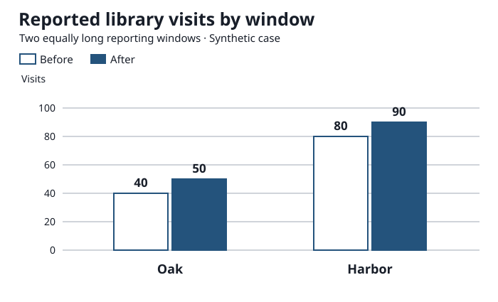

# First attempt: Read the figure

Use this fictional scenario without a chatbot. Save your response before reading the worked chapter.

A library consortium piloted a new reminder message at Harbor only. Staff show the totals from two equally long reporting windows. The totals count visits, not distinct people. No comparison design was specified. A manager requests a recommendation about expanding reminders to Oak.

[Accessible data table](../fixtures/visits.csv) (CSV: site, before visits, after visits).

The following is a **written example of a model-style response**, not output from a tested model:

> Harbor had 90 after the pilot and Oak had 50. Harbor gained more visits. Oak grew by 25% relative to its earlier total. The reminder accounted for Harbor’s increase, so Oak should switch as well.

1. Copy the four plotted values with their window labels and units. Don't calculate until you can point to each value.
2. Write the absolute change and baseline-relative change at each site. Show the denominator for each percentage.
3. Break the response into at least five claims or decisions. Mark supported, contradicted, or not established. Cite the cells you used for any numeric comparison.
4. Write one sentence to the manager that names a next step without promising an outcome.

Then read [Chapter 1](../chapters/01-make-the-claim-testable.md).
